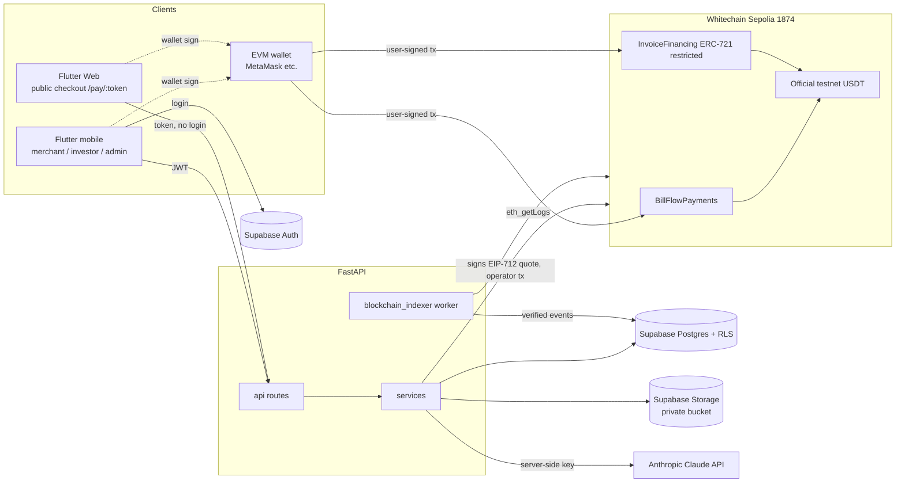

# BillFlow — Architecture (Step 1)

Status: **draft for review**. Nothing below has been deployed or tested on-chain yet.

## 1. System overview

```
 Flutter app (merchant / investor / admin)      Flutter Web  /pay/:token  (public checkout)
        │  supabase_flutter (Auth only)                    │  no login; wallet only
        │  Bearer <Supabase JWT>                           │
        ▼                                                  ▼
 ┌──────────────────────────── FastAPI ────────────────────────────┐
 │ api/ (thin routes) → services/ (business logic) → repositories/ │
 │ RBAC · validation · EIP-712 quote signer · Claude client        │
 └───────┬───────────────────┬───────────────────┬─────────────────┘
         │ service-role      │                   │ API key (server only)
         ▼                   ▼                   ▼
   Supabase Postgres    Supabase Storage     Anthropic Claude
   (+ RLS)              (private bucket)
         ▲
         │ verified events (idempotent upserts)
   workers/blockchain_indexer.py ──poll eth_getLogs──► Whitechain Sepolia (chain 1874)
                                                          ├─ BillFlowPayments
                                                          └─ InvoiceFinancing (ERC-721, restricted)
 Wallets (MetaMask etc.) sign and send all user transactions; the backend never holds user keys.
```

## 2. Principles

1. **Chain is the source of truth for money.** Only the indexer may set `PAID`, `FUNDED`, `SETTLED`. A client-submitted `tx_hash` is a hint that triggers an immediate verification attempt, never a status change.
2. **Backend is the only writer** of business tables (service-role key). RLS exists as defense in depth (see `supabase/migrations/0002_rls.sql`).
3. **Roles come from `profiles.role` in the database**, loaded per request. JWT claims and client-supplied roles are never trusted.
4. **AI is advisory.** Claude output is stored in `ai_extraction` / `ai_flags`; it can never change invoice review status, financing status, or trigger a transaction.
5. **Human gates:** invoice verification and financing approval are admin actions; `createOffer` on-chain is only callable by the operator key, which the backend uses only after an admin approval row exists.
6. **Confidential PDFs stay off-chain** (private bucket, signed URLs). On-chain: ids, hashes, amounts, addresses.

## 3. Roles & authorization

| Role | How obtained | Can |
|---|---|---|
| merchant | self-select at signup | own business, customers, invoices, payment links, financing requests |
| customer | default; also *anonymous* payers via public link | pay invoices, view own receipts (wallet-based) |
| investor | self-select at signup + admin verification | browse marketplace, fund offers (contract allowlist after verification) |
| admin | granted only by another admin / DB seed | verify businesses & invoices, approve financing, monitor all, set roles |

Auth flow: Flutter signs in with Supabase Auth → sends the access token to FastAPI → FastAPI verifies the signature (JWKS at `<SUPABASE_URL>/auth/v1/.well-known/jwks.json`, or the legacy HS256 secret — **check which your project uses**) → loads `profiles` row → dependency `require_role(...)` enforces access. Public checkout endpoints are token-based, not JWT-based.

## 4. Invoice & financing state machines

Invoice: `DRAFT → PENDING → (PARTIALLY_PAID →) PAID`; `PENDING/PARTIALLY_PAID → OVERDUE` (scheduled job, due date passed); `DRAFT/PENDING → CANCELLED`. Paid and cancelled are terminal. `PAID` is set only from confirmed `InvoicePaid` events.

Financing: `REQUESTED → UNDER_REVIEW → APPROVED → LISTED → FUNDED → SETTLED`; side exits `REJECTED`, `CANCELLED`, `EXPIRED` (funding deadline passed unfunded), `DEFAULTED` (unpaid after maturity + grace, operator action). An invoice with an active financing offer cannot be paid directly through `BillFlowPayments` (see contract spec §4) — repayment goes to `InvoiceFinancing`.

## 5. Technology decisions

| Decision | Choice | Why |
|---|---|---|
| Contract tooling | **Foundry** | Fast Solidity-native tests (reentrancy, fuzz), `forge script` deploys, `forge verify-contract`. Fallback if the Whitechain explorer rejects it: manual flattened-source verification. |
| Backend chain lib | web3.py | Event decoding, EIP-712 signing (`eth-account`). |
| Public checkout | Flutter Web | Customers need no install; browser wallet injection is the most reliable path for a live demo. |
| Mobile wallet | WalletConnect/Reown (stretch) | Higher integration risk; browser wallet is the demo-critical path. |
| Indexer | Polling `eth_getLogs` | Ankr's Whitechain endpoint is HTTPS only (no WSS). Confirmations depth configurable. |
| Money type | integer base units (`numeric(38,0)`) + `token_decimals` | No floating point; decimals still to be verified on-chain. |

## 6. Duplicate / replay protection (layers)

- Contract: `usedInvoiceHash`, one-time `fund`, cumulative `paidAmount` cap, EIP-712 quote expiry + nonce.
- DB: `unique(tx_hash, log_index)` on `payments` and `blockchain_events`; `unique(invoice_id)` on `financing_offers`; partial unique index on live `investments` per offer.
- Indexer: idempotent upserts; block range replay is safe; reorg handling via `block_hash` check and confirmation depth.

## 7. Known risks (carried from the Phase 1 review)

1. USDT address / decimals / test-token source for Whitechain Sepolia **unverified**.
2. Explorer contract-verification API unverified — test with a trivial contract first.
3. Legacy L1 testnet is chain 2625; use **1874** only.
4. Hot keys (EIP-712 signer, operator) — testnet-only, env vars, rotate after the event.
5. Legal framing: testnet model; NFT/position token ≠ legal assignment; debtor acknowledgement & assignment notice are separate off-chain records.

## 8. Mermaid architecture diagram



## 9. Data flows

**Auth.** Flutter → Supabase Auth (sign-up/in) → access token. Flutter → FastAPI with `Authorization: Bearer`. FastAPI verifies the token, then loads `profiles.role` from Postgres.

**Public payment.** Flutter Web loads `/public/pay/{token}` → user connects wallet, backend returns a signed EIP-712 quote → wallet sends `approve` + `payInvoice` to Whitechain → Flutter posts the `tx_hash` as a *hint* → indexer reads the `InvoicePaid` event after N confirmations → backend validates it against the invoice (id, merchant, amount, token) → writes `payments`, updates `invoices.status` → Flutter polls and shows the receipt.

**Financing.** Merchant requests → AI validation shown to reviewer (advisory) → admin verifies invoice + records debtor acknowledgement → admin approves → backend (operator key) calls `createOffer` → indexer sees `OfferCreated` → `LISTED` → investor wallet calls `fund` → indexer sees `OfferFunded` → debtor calls `repay` → indexer sees `OfferRepaid/Settled` → `SETTLED`.

**AI.** Flutter → FastAPI `/ai/*` → FastAPI reads the PDF from the private bucket → Claude (server-side key) → schema-validated JSON stored as advisory data. No AI output changes any status.

## 10. Flutter architecture

*Existing code:* none found (fresh repo), so no dependencies need to be preserved or inspected. The packages below are proposals; each is verified against pub.dev when added in Step 4.

**Folder structure (feature-first)**
```
app/lib/
  main.dart, app.dart
  core/        config/ (env), theme/ (blue/white light theme, tokens), router/, network/ (Dio client,
               auth interceptor, error mapping), wallet/, widgets/ (buttons, cards, status chips,
               loading/empty/error views), utils/ (money formatting from base units)
  data/        models/ (freezed + json_serializable), repositories/ (one per API group)
  features/
    auth/ (login, register, role choice), onboarding/ (business profile, wallet link)
    merchant/ (dashboard, invoices, customers, payments, financing, profile)
    checkout/ (public pay page, receipt, history)    ← also the Flutter Web entrypoint
    investor/ (marketplace, offer detail, portfolio, transactions)
    admin/ (users, businesses, invoices, financing review, monitoring)
```

**State management:** Riverpod (providers per repository, `AsyncNotifier` for screens). Chosen for testability and no `BuildContext` dependency; no extra framework beyond that.

**Routing:** `go_router` with a redirect guard: unauthenticated → login; authenticated → shell chosen by `profile.role` (merchant/investor/admin bottom-nav shells). Public routes `/pay/:token` and `/receipt/:txHash` bypass auth. Role is read from `GET /me`, never from the token claims.

**API layer:** Dio with an interceptor that attaches the Supabase access token, refreshes on 401, maps the standard error envelope to typed `AppException`s, and sends an `Idempotency-Key` on mutating calls.

**Wallet layer:** a `WalletService` interface with two implementations behind it: `BrowserWalletService` (EIP-1193 `window.ethereum`, Flutter Web — the demo-critical path) and `WalletConnectService` (Reown, mobile — stretch goal). Responsibilities: connect, detect/switch to chain 1874 (`wallet_addEthereumChain`), read USDT `balanceOf`/`allowance`/`decimals`, send `approve` and contract calls, return the `tx_hash`. The app never holds private keys and never decides a payment succeeded; it waits for the backend status.

**Theme:** light default, blue/white palette, one type scale, reusable `StatusChip`, `MoneyText`, `AsyncValueView` (loading/empty/error), `TxLink` (explorer link).
