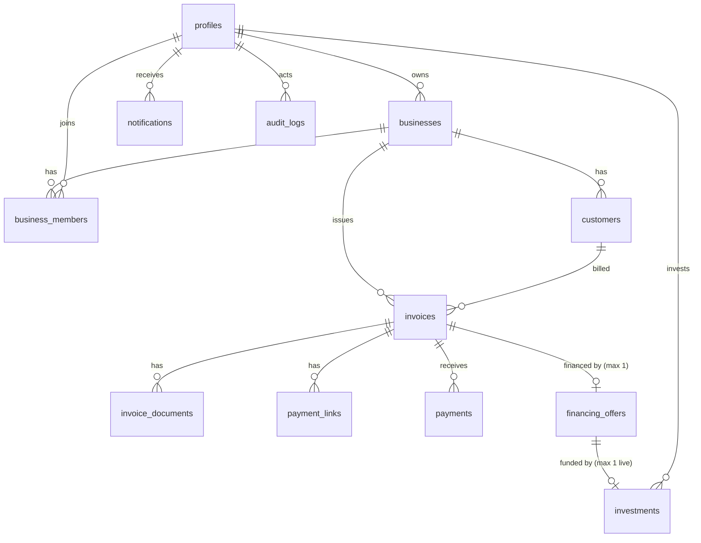

# BillFlow — Database schema (Supabase PostgreSQL)

Source of truth: `supabase/migrations/0001_init.sql` (schema) and `0002_rls.sql` (RLS, grants, storage bucket). **Not yet executed on any Supabase project.** Syntax was parsed locally; a real run is a manual step (see DEVELOPMENT_ROADMAP).

Conventions: UUID primary keys (`gen_random_uuid()`), `created_at`/`updated_at` timestamptz (updated via trigger), addresses/hashes stored lowercase and format-checked, money as `numeric(38,0)` base units + `token_decimals` (default 6 is a **placeholder** until the official USDT decimals are verified).

## Enums
`user_role` merchant|customer|investor|admin · `verification_status` unverified|pending|verified|rejected · `invoice_status` DRAFT|PENDING|PARTIALLY_PAID|PAID|OVERDUE|CANCELLED · `payment_status` PENDING|CONFIRMED|FAILED · `financing_status` REQUESTED|UNDER_REVIEW|APPROVED|LISTED|FUNDED|SETTLED|REJECTED|EXPIRED|CANCELLED|DEFAULTED · `investment_status` PENDING|CONFIRMED|SETTLED|FAILED · `tx_status` SUBMITTED|CONFIRMED|FAILED

## Tables

| Table | Key columns | PK | Foreign keys | Unique / checks | Indexes | Status field |
|---|---|---|---|---|---|---|
| profiles | role, display_name, email, wallet_address, investor_verification | id | id → auth.users | wallet_address unique + format | – | investor_verification |
| businesses | owner_id, legal_name, country, tax_id, payout_wallet, verified_by/at | id | owner_id, verified_by → profiles | wallet format | owner_id | verification_status |
| business_members | business_id, user_id, member_role | (business_id, user_id) | → businesses, profiles | member_role in owner/member | user_id | – |
| customers | business_id, name, email, wallet_address | id | business_id → businesses | wallet format | business_id | – |
| invoices | business_id, customer_id, invoice_number, description, amount_base, token_decimals, currency, issue/due_date, paid_amount_base, onchain_invoice_id, invoice_hash, paid_tx_hash, review_status, created_by | id | business, customer, created_by | unique(business_id, invoice_number); unique(onchain_invoice_id); due ≥ issue; paid ≤ amount | (business_id,status); customer_id; partial on due_date | status, review_status |
| invoice_documents | invoice_id (nullable until confirmed), business_id, storage_path, sha256, mime_type, size_bytes, ai_extraction, ai_confidence, ai_flags, uploaded_by | id | invoice (cascade), business, uploaded_by | storage_path unique; sha256 format; confidence 0–1 | invoice_id; sha256 (duplicate detection) | – |
| payment_links | invoice_id, token, expires_at, revoked_at | id | invoice (cascade) | token unique, ≥32 chars | invoice_id | derived from expires/revoked |
| payments | invoice_id, payer_wallet, amount_base, tx_hash, log_index, block_number, confirmed_at | id | invoice_id | **unique(tx_hash, log_index)** | invoice_id; payer_wallet | status |
| financing_offers | invoice_id, business_id, face_value_base, advance_base, maturity_date, funding_deadline, debtor_name/wallet, debtor_ack(+_at), assignment_notice, reviewed_by/at/notes, onchain_offer_id, create_tx_hash | id | invoice, business, reviewed_by | **unique(invoice_id)**; unique(onchain_offer_id); advance < face | status; business_id | status |
| investments | offer_id, investor_id, investor_wallet, amount_base, tx_hash, funded_at, repayment_base, repayment_tx_hash, settled_at | id | offer, investor | unique(tx_hash); **partial unique(offer_id) where status in PENDING/CONFIRMED/SETTLED** | investor_id | status |
| blockchain_transactions | tx_hash, chain_id, from/to, kind, related_type/id, block_number, confirmed_at | id | – (polymorphic related_*) | tx_hash unique | (related_type, related_id) | status |
| blockchain_events | chain_id, contract_address, event_name, tx_hash, log_index, block_number, block_hash, payload, processed_at | id | – | **unique(chain_id, tx_hash, log_index)** | block_number; partial on unprocessed | processed_at |
| indexer_state | chain_id, contract_address, last_block | (chain_id, contract_address) | – | – | – | – |
| notifications | user_id, type, title, body, read_at | id | user_id → profiles (cascade) | – | (user_id, created_at desc) | read_at |
| audit_logs | actor_id, action, entity_type, entity_id, metadata | id (identity) | actor_id | – | (entity_type, entity_id); (actor_id, created_at) | – |
| platform_settings | key, value (jsonb), updated_by | key | updated_by | – | – | – |

`indexer_state` and `platform_settings` are additions to your 14 required tables (needed for the indexer cursor and admin settings).

## Relationships

## Auth integration
`auth.users` insert → trigger `handle_new_user` creates `profiles`. Signup metadata may *request* `merchant` or `investor`; anything else (including `admin`) becomes `customer`. Admin is granted only through the backend by an existing admin or manually in SQL for the first admin. The backend reads `profiles.role`; JWT claims are never used for authorization.

## RLS summary (backend uses service-role and bypasses RLS)

| Table | Who can SELECT directly | Client writes |
|---|---|---|
| profiles | self; admin | update only display_name, wallet_address (column grant) |
| businesses, customers, invoices, invoice_documents, payment_links, payments, financing_offers | members/owner of the business; admin | none |
| business_members | self; members of that business; admin | none |
| investments | the investor; the financed business; admin | none |
| blockchain_transactions, blockchain_events, audit_logs, platform_settings | admin | none |
| indexer_state | nobody (no policy) | none |
| notifications | owner | only `read_at` |

Isolation: merchants never see other businesses; investors never read merchant tables (marketplace is a backend projection); customers (payers) have no table access — they use token-scoped public endpoints.

## Storage
Bucket `invoice-documents`: private, PDF only, 10 MB limit. No `storage.objects` policies for `anon`/`authenticated`, so only the backend (service role) reads/writes; users get 60-second signed URLs after an authorization check. Path convention: `{business_id}/{invoice_id|pending}/{uuid}.pdf` (server-generated).

## Step 2 alignment
`financing_offers.onchain_offer_id` stores the contract's sequential `invoiceId` (also the ERC-721 tokenId). `invoices.onchain_invoice_id` is the `bytes32` used by `BillFlowPayments`; `invoices.invoice_hash` feeds both contracts. Consider adding `documents.document_hash` and `debtor_ref`/`debtor_ack_hash` columns in Step 3 once the hash recipes are frozen.

## Known limitations / decisions
- `OVERDUE` is set by a scheduled backend job, not a DB trigger.
- `blockchain_transactions.related_*` is polymorphic (no FK) to keep one table for all tx kinds.
- `financing_offers.invoice_id` unique means a cancelled/rejected invoice cannot be re-requested without clearing the old row — decide in Step 3 whether to allow versioned re-requests.
